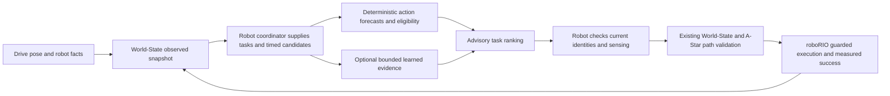

# Adaptive advisory decisions and planner handoff

This implementation proposes the next task from the coordinator's current
candidate set. Deterministic adaptive selection works without a trained model.
The robot still needs integration, measured sensing bindings, physical parameter
qualification and hardware validation. Every reply is advisory and cannot
authorize execution. No neighboring repository has been changed.

## Working capabilities

`DecisionService.evaluate` accepts strict `frc-decision-support/1` JSON and
returns a schema-valid recommendation. `LatestDecisionWorker.submit` returns a
future with one running request and one replaceable pending request. Superseded
pending futures are cancelled. Invalid or reordered submissions cannot cancel
healthy work. Service restart/reset changes its epoch; callers must refresh the
handshake and saved context. The service pins field, robot boot, localization,
configuration, world epoch and task revision. Obstacle-map changes and context
updates require new requests/generations.

`consume_decision_reply` requires the original and current request. It checks
all identities, hashes, robot-monotonic times and expiry, then reproduces scores,
eligibility, samples and selection from the supplied evidence. A changed current
snapshot/context requires recomputation. It never shifts forecast times forward.
This Python consumer is a reference for the future Java boundary, not an
existing robot adapter.

`safe_decision_roundtrip` exercises localhost NDJSON and recomputes the same
deterministic baseline after timeout, disconnect or rejected advice. Missing
occupancy/readiness/possession rejects dependent tasks and leaves neutral HOLD
where permitted. Stale or invalid authoritative input produces unavailable
advice: the robot's existing reactive fallback must decide its response.

Ranking uses configured utility minus route-distance/time proxies, proximity
risk, uncertainty and task-switching costs, plus short-horizon goal progress.
Tie-breaking is stable by task ID. Planner-supplied distance has explicit
provenance; straight-line distance is only a lower-bound proxy. All movement
tasks still require path planning. Open-loop body twists are integrated from the
observed cutoff with exact constant-twist kinematics; the final sample has no
subsequent interval. Instantaneous command tracking, envelope growth and radius
parameters remain unqualified assumptions. Swept moving-circle and field-envelope
screening can reject candidates, but cannot certify physical collision safety.

Established World-State tracks can be CONFIRMED at capture time or COASTING
after ordinary camera/processing latency. Both remain eligible only while the
original last-measurement age, configured minimum confidence and maximum variance
pass. TENTATIVE, invalid-time, stale or uncertain targets stay ineligible; an
engine-expired target is absent and cannot be recreated from an old reference.
The explicit `minimum_target_confidence` policy field must be supplied alongside
the other quality limits and aligned with the coordinator's TargetSelector
configuration; synthetic values are not robot qualification. Game/class utility,
coverage and reachability still require the authoritative coordinator's gates.

Regression fixtures are actual snapshots emitted by pinned WorldEngine Java
from synthetic inputs, including delayed cameras, coasting dropout, age boundaries
and engine expiry. They are stored in `contracts/decision-support-v1/
world-engine-lifecycle-fixtures.json`; `tools/generate_lifecycle_fixtures.py`
reproduces them from source pin `4590335421306da7964b5bd91dfa4da7922982ea`.
Ordinary tests consume the fixtures without a JDK or adjacent checkout.

Optional learned inference uses `LearnedEvidence` and the unchanged prediction
gate. It needs a pinned domain, approved model-specific calibration, finite PSD
covariance, matching identities/grid, in-domain outputs and remaining valid
future samples. An OOD, masked, uncertain, missing or failed predictor keeps the
baseline with an explicit reason. Qualified evidence may alter shadow scores or
further reject a candidate; it cannot override baseline/observed rejection.
Baseline and optional learned selections/scores are returned together over the
same candidates. The original learned reply is retained for consumer validation.

The existing `FrozenWireShadow` still emits canonical masked abstention. No
trained task model or approved physical covariance was created by this change.
Task-success probabilities, completion times and mechanism outcomes are null.
The offline outcome pipeline validates causal labels and supports train-only
fitting and disjoint held-out evaluation; see `DECISION_LEARNING.md`.

## Bounds and clocks

The companion profile bounds serialized request/reply size to 1 MB, candidates
to eight, history to 32, forecast samples to 101 and occupancy circles to 128.
Original embedded tracks, provenance and prediction targets keep World-State's
schema bounds. Supplied policy may tighten all limits. Request TTL and observation
ages are explicitly bounded. Host computation budgets are separate from exact
robot-monotonic microseconds; a mapped robot clock is mandatory.

One optional inference can be outstanding, including after a timeout. Further
inference is shed until that worker returns. Cancellation and generation fences
prevent late publication. Python threads cannot kill an uncooperative provider
or cap its allocations, and process exit can wait for it. A production
coprocessor adapter needs a supervised, killable process, explicit memory/time
limits and controller-to-coprocessor clock mapping. The current transport binds
localhost only; no live topic, network route or robot endpoint is configured.

Normal synthetic verification uses small fixtures and no GPU or large training.
The 105 GB whole-system ceiling is a deployment constraint, not a reason to
allocate that amount. Perception/concurrent-load and target-device measurements
remain required before deployment.

## Placement and robot bindings to plan next

Keep deterministic task generation/selection, World-State, A-Star, independent
collision supervision, command ownership and actuator writes on roboRIO.
Optional Python prediction belongs on an inventoried coprocessor, outside the
periodic path. Training and offline evaluation belong on the workstation.
An autonomous robot coordinator should submit current facts/candidates,
admit only current recommendations, ask the existing planner for paths, and
revalidate freshness, authority and mechanism state before every execution step.

The inspected robot has a Drive pose estimator and pose/chassis-speed getters.
Hood exposes readiness, intake readiness is private, shooter has no public
readiness getter, and inspected intake/indexer/feeder/shooter IO exposes no
measured possession sensor. Map unavailable bindings to UNKNOWN/null. Do not
infer possession from commanded intake, current, elapsed time or missing targets.
Only measured success may advance the actual task lifecycle.

Candidate generation should reuse World-State's `TargetSelector` and
`PickupController`; `PlannerBackend`/A-Star remain the path boundary. The
coordinator must supply truthfully validated path evidence and the actual timed
command hypothesis. Do not turn waypoints into invented command histories.
The scoring policy is explicit configuration: it does not encode official game
rules or grant permission to attempt a mechanism operation.

## Future adapter gaps retained by this correction

The reference consumer requires an exact current-request hash. A future async
robot adapter must read the latest authoritative context atomically after the
reply arrives and invalidate pending work on snapshot/task/source/fact changes.
Passing a saved request as both original and current cannot detect intervening
updates. Strict replacement may starve recommendations under faster updates;
this repository implements no relaxed admission rule or live coordinator.

Candidates describe independent open-loop alternatives from the cutoff, not
branching futures conditioned on what the robot actually executed during latency.
A future controller adapter needs a verified common accepted-action prefix or an
explicit future branching time, with logged execution deviations and revalidation.
Waypoints or a late reply cannot be rebased into such a prefix. There is no
closed-loop command hypothesis or post-cutoff execution join in this interface.

EMPTY/HELD/UNKNOWN is a measured single-possession prerequisite, not fuel count,
capacity, fullness or scored inventory. A multi-piece robot needs explicit
measured inventory semantics; "not verified held" cannot establish EMPTY.
Likewise the context currently has one source/time for several facts. A real
adapter must preserve each fact's own observation time, validity, source and
availability; a fresh aggregate stamp cannot refresh stale readiness/possession.
That richer fact/inventory interface remains future owner-contract work.

Optional inference threads cannot preempt CPU/allocation or guarantee process
shutdown. A killable, resource-limited worker, inventoried coprocessor and clock
mapping are still missing. None of these adapter gaps is implemented by this
correction; robot integration, live actuation and learned readiness remain on hold.

## Source and validation evidence

The starting source was clean main `ff5773923168acc6e39087aa583e67b619224609`.
Inspected neighbors were World-State
`4590335421306da7964b5bd91dfa4da7922982ea`, A-Star
`5ce7716bc8e3116cb35ed052e6809a1d59ce1e42`, and robot
`204bf62e2a3e0693a594c1348f1932f4ef164a52`.
Existing World-State schemas/vectors remained byte-identical. Java emitted the
same vectors and passed 109 assertions; Python abstention matched Java, whose
gate correctly retained `UNCALIBRATED` baseline behavior.

End-to-end tests cover changing targets/obstacles, delayed/dropout observations,
unknown or changed possession/readiness, conflicting goals, failed/OOD/uncertain
inference, timeout/overload, stale/reordered/duplicate/malformed input, service
reboot/epoch/clock rollback, cancellation/latest replacement and forged replies.
Dynamics tests cover turning, candidate isolation and between-sample collision
screening. All scenes and injected learned forecasts are synthetic software
evidence; no physical safety, learned ranking improvement or robot readiness is
certified.

Actual final local latency/resource results are recorded in
`docs/evidence/decision-support-benchmark.json` and
`docs/evidence/decision-support-validation.json`. They compare the same scene,
candidates and constraints against deterministic selection. A synthetic provider
that reproduces kinematics verifies admission/comparison plumbing; it is not a
trained model and supplies no production accuracy evidence.

The initial `0e0a336` Python suite passed **308 tests in 2.88 seconds**, with peak RSS
343,228,416 bytes. The 60-run benchmark measured direct baseline p95 7.76 ms,
loopback p95 18.10 ms and synthetic-provider p95 12.58 ms, with peak RSS
35,061,760 bytes. Both comparison modes agreed with baseline on 60/60 selections.
An isolated wheel install verified the packaged schemas and first baseline
request/consumption without loading PyTorch.

The separate resource-ceiling scene used eight candidates, 101 samples each,
128 obstacles and a two-second horizon (143,530 request bytes). Its 272.82 ms
processing time exceeded the supplied 250 ms budget, so the final publication
gate returned REJECTED without a recommendation. This is deliberate load shedding.
The budget checks bound admission/publication and stop between bounded candidate
chunks; they do not preempt Python parsing/validation or arbitrary model code.
See `docs/evidence/decision-support-ceiling.json`. Reproduce only this bounded
check with `tools/benchmark_decisions.py --ceiling --output <new-path>`.

Planner-review corrections and their current test/resource evidence are recorded
in `docs/evidence/decision-support-review-fixes.json`. The older measurements
above are preserved as historical evidence rather than silently reassigned to
the corrected implementation.

Remaining gates: authorized real causal histories and measured action deviations,
mechanism/possession/task outcome labels, multi-second task architecture and
trained checkpoints, independent held-out calibration/OOD evidence, measured
footprint/stopping/delay/response tolerances, a supervised coprocessor runtime,
Java request/reply adapters and hardware/shadow qualification under concurrent
perception load. Executed-action logs alone cannot establish counterfactual
candidate ranking. Whole-robot integration remains planning-only.
